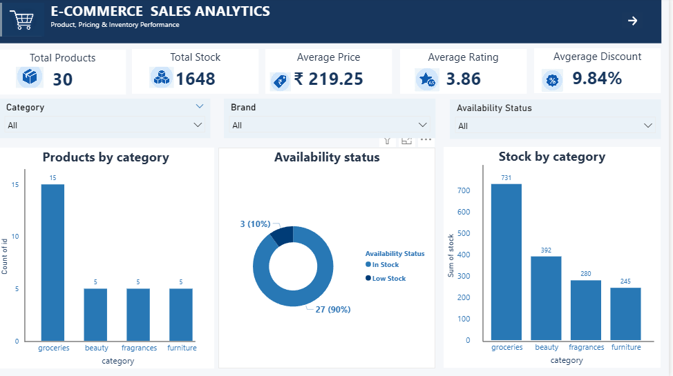
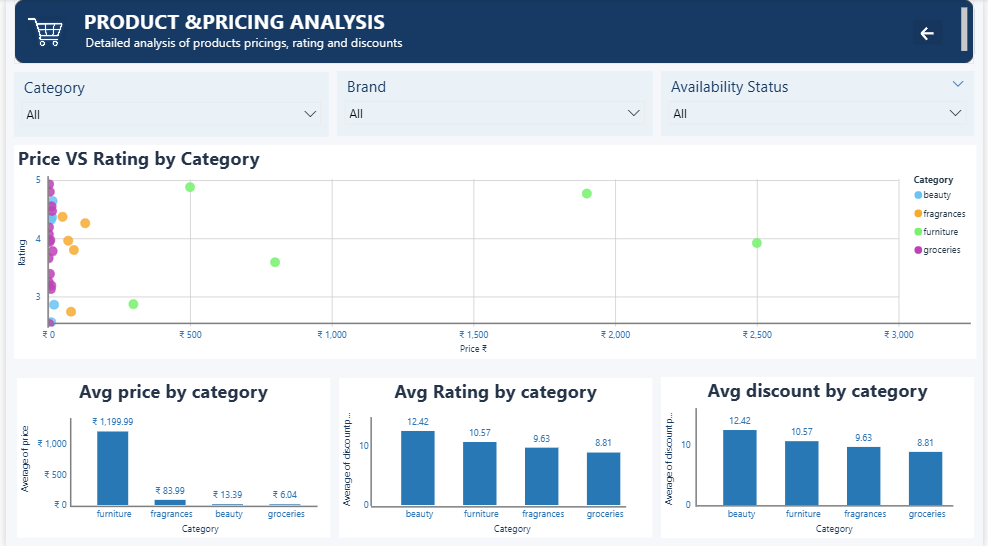

# E-Commerce Sales Analytics

An end-to-end data analytics project that collects product catalogue data from a REST API, cleans and transforms it using Python, stores it in PostgreSQL, analyzes it using SQL, and presents key metrics through an interactive Power BI dashboard.

## Project Overview

This project demonstrates a practical data analytics workflow using product data from the DummyJSON Products API.

The project covers data ingestion, data cleaning, transformation, database loading, exploratory data analysis (EDA), SQL-based analysis, and interactive dashboard development.

The objective is to turn raw product data into a structured dataset that can be analyzed and presented through meaningful visualizations.

> **Data note:** The current API response contains 30 product records. This is product catalogue data, not actual customer orders, sales transactions, or company revenue data.

## Business Objectives

- Analyze product pricing and discount patterns.
- Understand product distribution across categories.
- Compare stock availability across product categories.
- Explore product ratings and availability status.
- Store processed data in PostgreSQL for querying.
- Build an interactive, multi-page Power BI dashboard.
- Communicate data-driven observations through visualizations.

## Technology Stack

| Technology | Purpose |
|---|---|
| Python | Data ingestion, cleaning, and transformation |
| Pandas | Data manipulation and analysis |
| NumPy | Numerical operations |
| Requests | REST API data collection |
| PostgreSQL | Structured data storage |
| SQL | Data validation and analytical queries |
| Matplotlib & Seaborn | Exploratory data visualization |
| Jupyter Notebook | Interactive analysis |
| Power BI | Interactive dashboards and KPI reporting |
| Git & GitHub | Version control and project documentation |

## Data Source

**API:** [DummyJSON Products API](https://dummyjson.com/products)

The API provides sample product catalogue information, including:

- Product ID and title
- Category and brand
- Price and discount percentage
- Product rating
- Stock quantity
- Availability status

The current ingestion script collects the API response used by the project. The dataset currently contains 30 records; pagination and broader data collection are planned improvements.

## Project Workflow

1. **Data Ingestion:** Fetch product data from the REST API using Python.
2. **Raw Data Storage:** Save the API response as a JSON file.
3. **Data Cleaning:** Select required columns, convert data types, and handle missing or duplicate records.
4. **Data Transformation:** Standardize column names, trim text values, and replace missing brand values with `Unknown`.
5. **Database Loading:** Load the processed dataset into PostgreSQL.
6. **Data Validation:** Check row counts, missing values, and duplicate product IDs.
7. **SQL Analysis:** Query product prices, categories, stock, ratings, and discounts.
8. **Exploratory Data Analysis:** Explore patterns and compare product categories.
9. **Power BI Reporting:** Present key metrics and comparisons in a multi-page dashboard.
10. **Documentation:** Record project objectives, workflow, findings, and future improvements.

## Data Pipeline

The current workflow follows this sequence:

```text
DummyJSON Products API
          |
          v
Python API Ingestion
          |
          v
Raw JSON Data
          |
          v
Data Cleaning & Transformation
          |
          v
Processed CSV Dataset
          |
          v
PostgreSQL Database
          |
          v
SQL Analysis & Validation
          |
          v
Power BI Dashboard
```

The pipeline is currently run through project scripts. Fully automated scheduled ingestion and automatic dashboard refresh are future enhancements, not confirmed features of the current implementation.

## Power BI Dashboard

The dashboard contains two report pages designed to explore the product catalogue.

### Page 1 — Product Overview

This page summarizes the main product metrics and inventory distribution.

- Total Products
- Total Stock
- Average Price
- Average Rating
- Average Discount
- Products by Category
- Availability Status
- Stock by Category



### Page 2 — Product and Pricing Analysis

This page focuses on comparing prices, ratings, and discounts across product categories.

- Price vs. Rating Analysis
- Average Price by Category
- Average Rating by Category
- Average Discount by Category



## Key Metrics

The current dashboard reports the following values for the 30-record dataset:

| Metric | Value |
|---|---:|
| Total Products | 30 |
| Total Stock | 1,648 |
| Average Price | ₹219.25 |
| Average Rating | 3.86 |
| Average Discount | 9.84% |

*These values describe the current product dataset and may change when the data is updated. They are catalogue metrics, not sales or revenue KPIs.*

## Key Insights

Based on the current analysis of 30 product records:

- **Product Distribution:** Groceries is the largest category, containing 15 products, or 50% of the dataset.
- **Highest Average Price:** Furniture has the highest reported average price at ₹1,199.99.
- **Lowest Average Price:** Groceries has the lowest reported average price at ₹6.04.
- **Stock Distribution:** Groceries has 731 units in stock, approximately 44.4% of the total stock.
- **Highest Average Rating:** Furniture has the highest reported average rating at 4.01 out of 5.
- **Discount Comparison:** Beauty products have the highest reported average discount at 12.42%.

### Business Observations

- Furniture has a higher average listed price than the other categories in this dataset.
- Groceries account for the largest share of listed products and available stock.
- Product ratings and discount percentages vary across categories.
- These comparisons can help demonstrate how catalogue data supports product and inventory analysis.

*All findings are limited to the available sample. They should not be interpreted as evidence of actual sales performance, revenue, customer preferences, or purchasing behaviour.*

## Data Quality Checks

The current cleaning and transformation workflow includes:

- Selecting required columns.
- Converting numerical fields to appropriate data types.
- Removing duplicate product IDs.
- Handling missing required values.
- Replacing missing brand values with `Unknown`.
- Checking missing values after transformation.
- Validating the processed record count before database loading.

The latest confirmed database load contained 30 CSV rows and 30 rows in the `products_transformed` table.

## Project Structure

The main project components include:

```text
Sales-analytics/
├── data/
│   ├── raw/
│   └── processed/
├── dashboard/
│   └── Power BI (.pbix) files
├── docs/
├── image/
│   ├── Dashboard_page1.png
│   └── Dashboard_page2.png
├── notebook/
│   └── 01_eda_products.ipynb
├── sql/
│   └── 01_business_analysis.sql
├── src/
│   ├── ingestion/
│   │   └── api_client.py
│   ├── analysis/
│   ├── cleaning/
│   │   └── clean_products.py
│   ├── transformation/
│   │   └── clean_data.py
│   └── database/
│       └── load_to_postgres.py
├── .gitignore
├── README.md
└── requirements.txt
```

*This is a representative structure based on the project components discussed. Before publishing, verify every folder and filename against your actual repository and remove any entries that do not exist.*

## How to Run the Project

### 1. Clone the repository

```bash
git clone https://github.com/shrutijaiswal0751/ecommerce-sales-analytics.git
cd ecommerce-sales-analytics
```

### 2. Create and activate a virtual environment

On Windows PowerShell:

```powershell
python -m venv .venv
.\.venv\Scripts\Activate.ps1
```

### 3. Install dependencies

```powershell
pip install -r requirements.txt
```

### 4. Configure PostgreSQL

Create or use the PostgreSQL database `ecommerce_analytics`.

Configure the following environment variables in a local `.env` file in the project root:

```text
DB_HOST=localhost
DB_PORT=5432
DB_NAME=ecommerce_analytics
DB_USER=postgres
DB_PASSWORD=your_local_password
```

Replace the password placeholder with your own local PostgreSQL password. Never commit the real `.env` file to GitHub.

### 5. Run the pipeline scripts

Run the scripts from the project root using the paths that exist in your repository:

```powershell
python src/ingestion/api_client.py
```

```powershell
python src/cleaning/clean_products.py
```

```powershell
python src/transformation/clean_data.py
```

```powershell
python src/database/load_to_postgres.py
```

The database loading script expects the processed CSV and the PostgreSQL table `public.products_transformed` to exist.

*Run the cleaning command only if the corresponding file exists at that path. If your actual cleaning script is in a different folder, use its real path.*

### 6. Open the Power BI dashboard

Open the `.pbix` file from the `dashboard/` folder in Power BI Desktop. If the data source needs to be configured or refreshed, follow the connection settings used in your local report.

## What I Learned

- Collecting data from a REST API using Python.
- Cleaning and transforming data using Pandas.
- Working with CSV and JSON files.
- Connecting Python applications to PostgreSQL.
- Loading processed data into a relational database.
- Validating data quality and database record counts.
- Writing SQL queries for product analysis.
- Building KPI cards, charts, slicers, and report navigation in Power BI.
- Documenting a data analytics workflow with Git and GitHub.

## Future Improvements

- Implement API pagination to collect more product records.
- Automate ingestion and transformation with a scheduled pipeline.
- Add stronger schema validation and data quality tests.
- Expand SQL analysis and document analytical queries.
- Configure a reliable Power BI data refresh process.
- Add historical snapshots to track changes in price and stock.
- Explore AI-based product insights and anomaly detection.
- Add a reproducible setup guide and pipeline execution logs.

## Author

**Shruti**

Aspiring Data Analyst | Python | SQL | PostgreSQL | Power BI | Excel

[GitHub Profile](https://github.com/shrutijaiswal0751)
